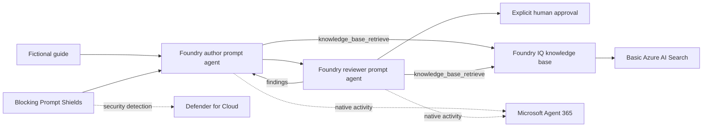
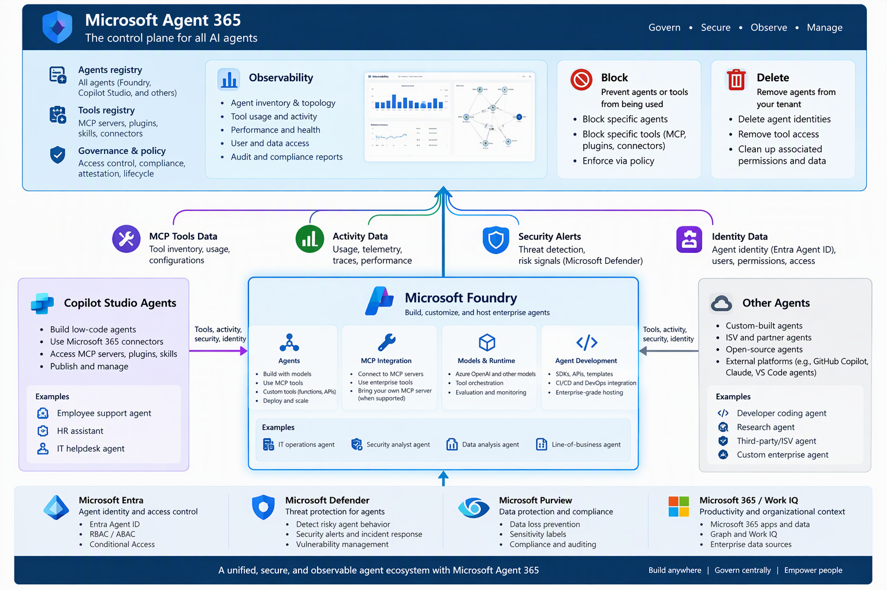

# Training knowledge check

Two **Microsoft Foundry prompt agents**, backed by **gpt-5.6-luna**, turn a fictional equipment-checkout guide into five multiple-choice knowledge checks. An independent reviewer finds ambiguous questions; the author repairs them; a human must explicitly approve the result.

This is a neutral workplace-training demonstration, not an academic assessment product. It contains no customer identifiers, learner records, proprietary material, or high-stakes scoring.

## What actually runs



- Both agents are persisted, versioned `kind: prompt` resources with distinct native Entra agent identities.
- The current **Agents API** creates them. Runtime calls use each agent's **Responses endpoint**, with 100% routing to the saved version. There are no classic assistants, threads, runs, direct-model agents, or deterministic runtime.
- Pydantic defines structured outputs and enforces shape, exact citations, known objectives, review references and approval state. It does **not** author questions, perform the independent review or prove semantic correctness.
- A365 uses **native Foundry collection**, not fabricated events or separate duplicate agent registrations.
- An optional scripted Foundry IQ deployment adds a **Basic-tier Azure AI Search** service, a seeded guide/rubric index, a knowledge source and a reusable knowledge base. Both prompt agents call its built-in read-only MCP retrieval tool; no Azure Function is involved.
- The security case injects a harmless synthetic instruction override. A blocked request or reviewer finding is **not** proof of a Defender alert; verification requires a real matching alert.

## Deploy a fresh project

Prerequisites: Python 3.11+, [uv](https://docs.astral.sh/uv/), PowerShell 7, Azure CLI and an Azure subscription with `gpt-5.6-luna` quota in East US 2. Sign in to the intended tenant/subscription first:

```powershell
az login
az account set --subscription '<subscription-id>'
.\scripts\Initialize-Demo.ps1
.\scripts\Provision-Demo.ps1
.\scripts\Provision-Demo.ps1 -Apply
.\scripts\Deploy-Agents.ps1
.\scripts\Deploy-Agents.ps1 -Apply
.\scripts\Test-Prerequisites.ps1
.\scripts\Invoke-Demo.ps1 -Scenario mixed -Count 3
```

`Provision-Demo.ps1` previews Bicep changes unless `-Apply` is given. It creates a dedicated resource group, Foundry account and project, GPT-5.6 Luna (`2026-07-09`, GlobalStandard), blocking Prompt Shields and project-scoped Foundry User access. Local keys are disabled. The demo uses a public endpoint secured by Entra authentication; this is **not** a private-network production blueprint.

Choose a fresh `-EnvironmentName` to isolate another deployment. Tenant-specific outputs and native identity bindings are written under ignored `.local`; responses and receipts go under ignored `results`. Never commit either directory.

**A365 administrator activation is required.** A licensed tenant must have Agent 365 activated and required terms accepted. Bicep enables account logging, but cannot accept tenant terms or assign licenses. Preflight fails unless the resource reports native A365 collection enabled. See [setup](docs/setup.md).

## Add Foundry IQ knowledge and real tool calls

After deploying the project and both agents:

```powershell
# Preview Basic Search infrastructure and RBAC
.\scripts\Deploy-Knowledge.ps1 -SearchLocation eastus
# Provision, seed, create KB/connection, verify retrieval, update both agent versions
.\scripts\Deploy-Knowledge.ps1 -SearchLocation eastus -Apply
# Live clean/ambiguous/repaired runs; require real successful retrieval calls
.\scripts\Test-Knowledge.ps1
```

Everything is codified: `infra/knowledge.bicep` provisions Search and least-privilege RBAC; `setup-knowledge` loads the canonical fictional guide plus review rubric, creates the knowledge source/base and a **project-managed-identity** connection, and verifies returned source references. `attach-mcp` creates new prompt-agent versions and routes their endpoints without replacing native agent identities. Private before-snapshots and creation receipts support recovery.

Search uses one Basic replica/partition, keyless authentication, keyword search and semantic ranking. The knowledge base uses the existing **gpt-5.6-luna** deployment for query planning; no extra model or embedding deployment is required. Basic Search incurs ongoing charges; the free semantic allowance is finite. Search defaults to East US because East US 2 rejected new Search provisioning due to capacity during setup; `-SearchLocation` is explicit and independent of the model's East US 2 region. Cross-region retrieval is not a data-residency blueprint.

The only allowed MCP tool is `knowledge_base_retrieve`. Noninteractive approval is intentional for this read-only, synthetic-data tool. The generator rejects missing/failed tool calls and saves actual `*-tool-calls.json` service evidence. This proves tool execution, **not A365 portal visibility** or registration as a separate Agent 365 tool-catalog server. Check both native identities and the run window in A365 before claiming visibility.

## Generate demonstrable activity

```powershell
# Real calls: clean draft, seeded ambiguity, then author repair plus rereview
.\scripts\Invoke-Demo.ps1 -Scenario mixed -Count 3
# Generate more real invocations for the two native agent identities
.\scripts\Invoke-Demo.ps1 -Scenario mixed -Count 12
```

Each run saves source, actual service responses, request/response receipts, agent version/identity bindings and review results. The ambiguous scenario deliberately modifies one real author question into a two-answer question before sending it to the real reviewer. This is a fault-injection input, not a simulated agent.

In Agent 365, locate `knowledge-author` and `knowledge-review` by their native identities, inspect activity around the run timestamps and save the portal evidence privately. A successful generator proves Foundry execution and prerequisites, **not portal ingestion**. Manifests explicitly keep `a365_readback_verified: false` until independently verified. See [verification](docs/verification.md).

Human approval is separate and never automatically generated:

```powershell
uv run --no-sync knowledge-check approve `
  --input 'results\<batch>\<run-id>\artifact.json' `
  --output 'results\<batch>\<run-id>\approved.json' `
  --human 'Demo reviewer' --confirm-reviewed
```

Review the artifact first. Only clean `ready_for_human` artifacts can be approved. This records a local attestation; it is not an authenticated enterprise approval system or automatic publication.

## Defender for Cloud scenario

```powershell
.\scripts\Test-Prerequisites.ps1 -Security
# Only if the subscription needs the PAID plan/evidence setting:
.\scripts\Enable-Defender.ps1 -IncludePromptEvidence
.\scripts\Enable-Defender.ps1 -IncludePromptEvidence -Apply
.\scripts\Test-SecurityScenario.ps1
```

The Defender plan is subscription-wide and paid; **normal provisioning does not enable it**. Prompt evidence can retain suspicious prompt snippets. The opt-in script previews the change, preserves existing extensions and saves a private before-snapshot. Read [security prerequisites and limitations](docs/security.md) before applying it.

The source contains only an instruction override and a unique harmless canary: no credentials, malicious code, exfiltration or real customer data. Detection is service-dependent and may not occur. The verification command exits unsuccessfully if no exact-run real Defender alert is found. Do not present a sample alert or an LLM finding as a Defender detection.

## Development

```powershell
uv run ruff check .
uv run ruff format --check .
uv run pytest
az bicep build --file .\infra\main.bicep --stdout
```

Tests mock cloud boundaries only; the application has no offline provider. CI checks Python, PowerShell syntax and Bicep on Windows and Linux. Live execution requires Azure permissions and incurs model charges.

## Reference architecture



User-supplied Microsoft reference artwork, retained for context; it is not evidence that every illustrated service is implemented here. Microsoft artwork/trademarks remain with their respective owners and are not licensed by this repository's MIT code license.

## Cleanup

Remove the dedicated demo resource group in Azure after reviewing its contents. Deleting the project also removes its agents; review any retained Entra agent identity objects and tenant retention requirements separately. Do not disable shared subscription Defender protection as a demo cleanup step. Changes to Defender pricing require an administrator's separate decision.
